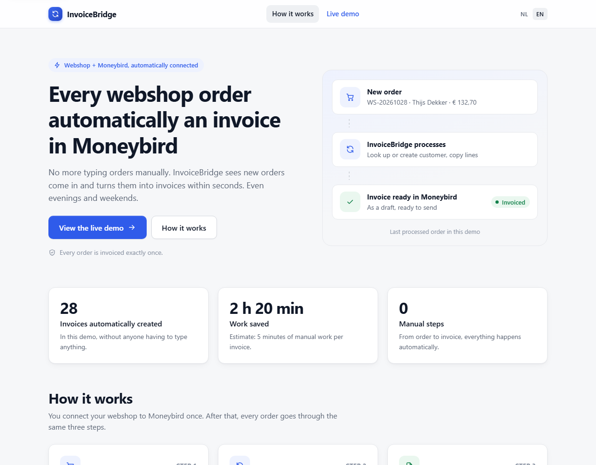
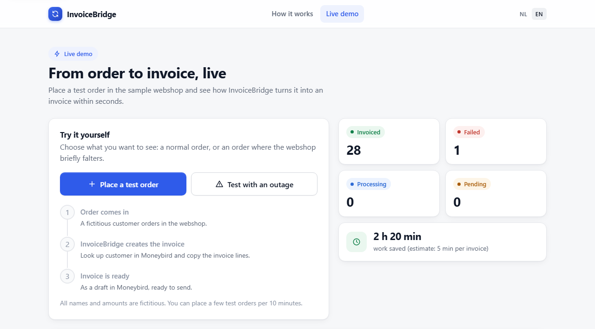
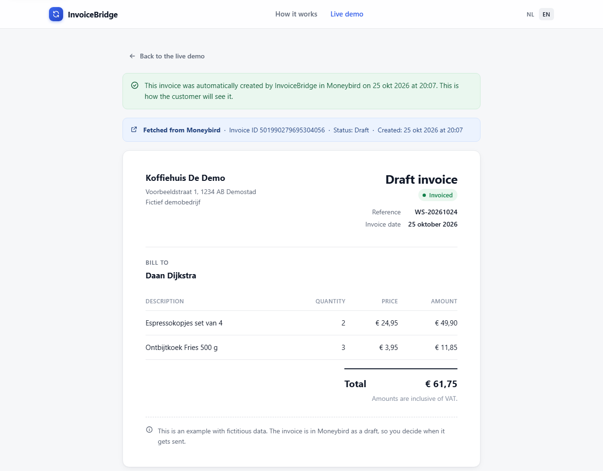
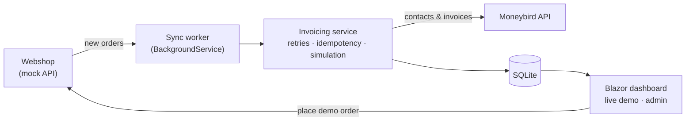

# InvoiceBridge

**Webshop orders become Moneybird invoices automatically. No more copying orders into your bookkeeping by hand.**

Many small webshops still retype every order into their accounting software: customer, products, amounts. That is slow and error-prone, and it piles up during busy weeks. InvoiceBridge watches the webshop for new orders and turns each one into an invoice in [Moneybird](https://www.moneybird.nl/) within seconds, evenings and weekends included.

> This is a portfolio project. It runs against a mock webshop and a Moneybird sandbox, using fictitious data only.

## Screenshots

| Landing page | Live demo | Invoice |
|---|---|---|
|  |  |  |

## Features

- **Automatic Moneybird invoices**: a background worker picks up new orders, finds or creates the contact and creates the invoice.
- **Automatic retries**: a failed order is retried on every sync cycle, up to 5 attempts, and can also be retried manually from the dashboard.
- **Idempotent (no duplicate invoices)**: before creating an invoice, InvoiceBridge checks Moneybird for an existing invoice with the order reference, so it is safe after a crash or restart.
- **Error handling with an outage demo**: one click simulates a webshop outage, so you can watch the order fail, show a clear message and recover.
- **Simulation mode at the sandbox limit**: when the monthly sandbox invoice limit is near, or Moneybird returns `402`, the app switches to simulated invoices instead of failing.
- **Admin login**: a code-protected admin view (HMAC-signed, HttpOnly cookie) with sandbox usage and links to the real Moneybird invoices.
- **Public demo safeguards**: per-visitor, daily and total limits on demo orders.
- **Dutch and English UI**.

## Tech stack

| | |
|---|---|
| Runtime | .NET 10 |
| UI | Blazor Web App (Interactive Server) |
| Data | EF Core + SQLite |
| Background processing | `BackgroundService` |
| Integration | Moneybird REST API v2 |
| Tests | xUnit |

## Architecture



## Running locally

**Requirements:** [.NET 10 SDK](https://dotnet.microsoft.com/download) and a Moneybird account with a sandbox administration and an API token.

Secrets are never stored in the repository. Set them with user-secrets:

```bash
cd src/OrderSync
dotnet user-secrets set "Moneybird:Token" "<your-moneybird-api-token>"
dotnet user-secrets set "Moneybird:AdministrationId" "<your-administration-id>"
dotnet user-secrets set "Admin:AdminCode" "<choose-an-admin-code>"
```

Then run the app:

```bash
dotnet run --project src/OrderSync
```

Open <http://localhost:5168>. The database is created and migrated on startup. Without Moneybird secrets the app still starts, but invoicing is disabled.

Run the tests with:

```bash
dotnet test
```

## About me

Built by **[Your Name]**, .NET developer.

[LinkedIn](https://www.linkedin.com/in/your-profile/)
